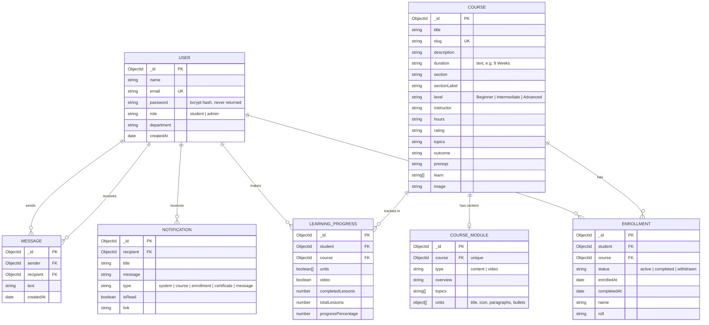

# Database design (Task 11)

MongoDB database: `faceprep_course_system` (change it in `MONGO_URI`).
Seven collections, defined in `backend/models/`.

## ER diagram

## Relationships in plain words

* A **user** (student) can enrol in many **courses**; a course has many students.
  `Enrollment` is the join collection between them (many-to-many).
* `LearningProgress` stores how far one student has got in one course
  (one record per student + course).
* A course has at most one stored **module** (its learning content). Courses an
  admin adds later have no stored module; a generic one is generated for them.
* A user receives many **notifications**, and sends / receives many **messages**.

## Indexes

| Collection | Index | Why |
|---|---|---|
| users | `email` **unique** | no two accounts with one email |
| courses | `slug` **unique** (sparse), `section` | friendly id, catalog grouping |
| modules | `course` **unique** | one content document per course |
| enrollments | `{student, course}` **unique**, `course` | cannot enrol twice; "who is in this course" |
| learningprogresses | `{student, course}` **unique** | one progress record per student per course |
| notifications | `{recipient, createdAt:-1}` | "my newest notifications" |
| messages | `{sender, recipient, createdAt:-1}`, `{recipient, sender, createdAt:-1}` | conversation history |

(The unique `email` index is declared once, on the field, so Mongoose does not warn about a duplicate index.)

## Deleting data (referential integrity)

MongoDB does not enforce foreign keys, so the services do it:

| When you delete… | These are removed too |
|---|---|
| a **student** | their enrollments, learning progress, notifications, and every chat message they sent or received |
| a **course** | its enrollments, learning progress and stored module |
| Admin "Clear All" (enrollments) | all enrollments and all learning progress |
| **withdraw** from a course | nothing is removed: the enrollment becomes `status: "withdrawn"` |

On Atlas (a replica set) these run inside one transaction. On a plain
standalone `mongod` (no transactions) the same steps run one after another.

## Notes on the schema

* `password`, `resetTokenHash` and `resetExpires` are `select: false` **and** stripped in `toJSON`, so they can never leak in a response.
* Every document is returned with both `_id` and `id` (a string copy), so the React pages and the task examples both work.
* `duration` is **text** ("8 Weeks") — this project's forms and data use text, not a number of hours.
* Course `description` falls back to the course `outcome` when the form does not provide one.
* Statuses: `active` (was "in-progress"), `completed`, `withdrawn`.
